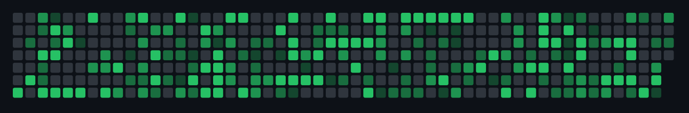

# grindgrid

A GitHub-style contribution graph for workouts. Every square is a day; it lights up when you trained.
Activities come from the Strava API, the grid lives on a small self-hosted server, and an iPhone
home-screen widget shows it at a glance.


*Screenshots use generated demo data.*

## Themes

| Theme | Colour means | |
|---|---|---|
| `binary` (default) | trained that day or not |  |
| `intensity` | total training time that day: ≤30 min, ≤60, ≤90, 90+ |  |
| `sports` | sport with the most time that day: run, ride, strength, swim, walk, other |  |

## How it works

```
Strava API ──(hourly, systemd timer)──> grindgrid.sync ──> SQLite
                                                             │
                     browser  <── GET /           (SVG)  ────┤ grindgrid.web
       Scriptable widget (iOS) <── GET /api/days  (JSON) ────┘
```

- **Zero runtime dependencies**: Python standard library only (`urllib`, `sqlite3`, `http.server`, `zoneinfo`).
- **Sync** pulls the full history on first run. After that it re-fetches the last 30 days each hour,
  which picks up edits, and drops activities deleted on Strava within that window.
  `python -m grindgrid.sync --full` re-syncs everything.
- **Days** are bucketed by the activity's local start date. Several workouts on one day add up.
  Manual entries with no moving time fall back to elapsed time.
- **OAuth tokens** are refreshed automatically. Strava rotates the refresh token, and the new one is saved each time.
- **Widget**: `widget/grindgrid.js` runs in [Scriptable](https://scriptable.app). The server computes
  every day's level and colour group; the widget only draws, and it shows the last cached grid when offline.
- The server is meant for a home network or a VPN such as Tailscale. It has no auth of its own,
  so don't expose it to the internet.

## Run it locally with demo data

```bash
export GRINDGRID_DATA=./data
python -m grindgrid.sync --demo     # fake activities, no network
python -m grindgrid.web             # http://localhost:8080
python -m unittest                  # tests
```

## Connect a real Strava account

1. Create an API application at <https://www.strava.com/settings/api> with
   **Authorization Callback Domain** set to `localhost`.
2. Put the client ID and secret in an env file (see `.env.example`, or `/etc/default/grindgrid` on a server).
3. Open `http://localhost:8080/auth` and approve. On a remote box, tunnel first:
   `ssh -L 8080:localhost:8080 <server>`.
4. Run `python -m grindgrid.sync` once, or let the timer do it.

Server install: copy the repo to `/opt/grindgrid`, create a `grindgrid` system user that owns
`/var/lib/grindgrid`, then install the units from `deploy/` and enable
`grindgrid-web.service` and `grindgrid-sync.timer`.

## iPhone widget

1. Install Scriptable and create a new script from `widget/grindgrid.js`.
2. Add a Scriptable widget (small, medium or large), choose the script, and set **Parameter** to
   `http://<server>:8080;intensity`. The theme part is optional.

---

Powered by Strava. Not affiliated with or endorsed by Strava.
