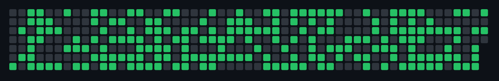

# grindgrid

A GitHub-style contribution graph for workouts. Every square is a day; it lights up when you trained.
Activities come from Garmin Connect, the grid lives on a small self-hosted server, and an iPhone
home-screen widget shows it at a glance.



*Screenshots use generated demo data.*

## Themes

| Theme | Colour means | |
|---|---|---|
| `binary` (default) | trained that day or not |  |
| `intensity` | total training time that day: ≤30 min, ≤60, ≤90, 90+ |  |
| `sports` | sport with the most time that day: run, ride, strength, swim, walk, other |  |

## How it works

```
Garmin Connect ──(hourly, systemd timer)──> grindgrid.sync ──> SQLite
                                                             │
                     browser  <── GET /           (SVG)  ────┤ grindgrid.web
       Scriptable widget (iOS) <── GET /api/days  (JSON) ────┘
```

- **Small footprint**: the grid, storage and web server use only the Python standard library (`sqlite3`, `http.server`, `zoneinfo`).
  The single dependency, [python-garminconnect](https://github.com/cyberjunky/python-garminconnect), is used only for syncing.
- **Sync** pulls the full history on first run. After that it re-fetches the last 30 days each hour,
  which picks up edits, and drops activities deleted in Garmin Connect within that window.
  `python -m grindgrid.sync --full` re-syncs everything.
- **Days** are bucketed by the activity's local start date. Several workouts on one day add up.
  Manual entries with no moving time fall back to elapsed time.
- **Login** happens once, interactively, with MFA supported. The password is never stored; only session tokens are,
  and the library refreshes them automatically.
- **Widget**: `widget/grindgrid.js` runs in [Scriptable](https://scriptable.app). The server computes
  every day's level and colour group; the widget only draws, and it shows the last cached grid when offline.
- The server is meant for a home network or a VPN such as Tailscale. It has no auth of its own,
  so don't expose it to the internet.

## Run it locally with demo data

```bash
export GRINDGRID_DATA=./data
python -m grindgrid.sync --demo     # fake activities, no network, no dependencies
python -m grindgrid.web             # http://localhost:8080
python -m unittest                  # tests
```

## Connect a Garmin account

```bash
python -m venv venv && venv/bin/pip install -r requirements.txt
venv/bin/python -m grindgrid.garmin     # asks for e-mail, password, MFA code; stores tokens in $GRINDGRID_DATA/garmin
venv/bin/python -m grindgrid.sync       # first run pulls the full history
```

Server install: copy the repo to `/opt/grindgrid`, create a venv there, and create a `grindgrid`
system user that owns `/var/lib/grindgrid`. Run the login as that user, then install the units
from `deploy/` and enable `grindgrid-web.service` and `grindgrid-sync.timer`.

## iPhone widget

1. Install Scriptable and create a new script from `widget/grindgrid.js`.
2. Add a Scriptable widget (small, medium or large), choose the script, and set **Parameter** to
   `http://<server>:8080;intensity`. The theme part is optional.

---

grindgrid uses an unofficial Garmin Connect client. It is not affiliated with or endorsed by Garmin,
and it can break whenever Garmin changes its login flow.
